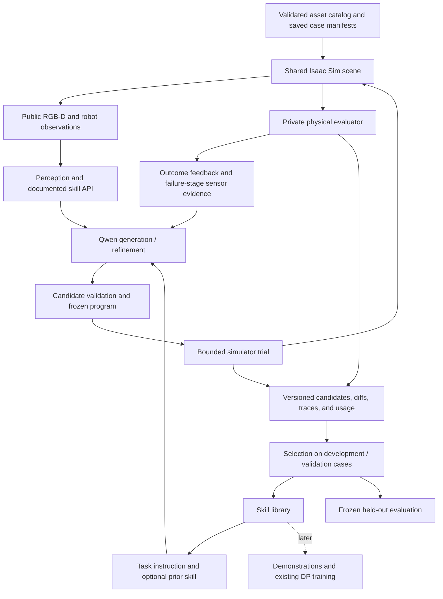

# ASPIRE research goals, architecture, and experiment plan

Prepared: **2026-10-04, Asia/Taipei**. This document defines the next study; proposed assets, APIs, evaluators, and experiments are not yet implemented unless explicitly marked as existing. Existing implementation history and trial evidence remain in [ASPIRE.md](ASPIRE.md).

## 1. Research goal

The senior's objective is:

> 就是我們會想把產生不同器材夾取的腳本/技能生成自動化。
>
> 你可以測試一下不同種類的器材，例如較薄的或重心不在中間的，讓他試試看能不能夾取。

**Automate the generation and refinement of reusable grasping skills for instruments with different geometry and mass distributions, reducing the need to write and tune a separate script for every instrument.**

The intended output is a versioned library of executable sensor-based skills, with measured capabilities and limits. A successful skill should work across placements and orientations, rather than memorize a scene or seed.

Primary research question:

> Can an ASPIRE-based generation/refinement workflow produce reliable grasping skills for unfamiliar thin and asymmetric instruments, under a fixed development budget and without manually writing their grasping logic?

Secondary questions:

- Does simulator feedback improve a generated skill over its first version?
- Does reusing earlier skills reduce the number of trials and model requests needed for a new object?
- Which failures arise from perception, contact geometry, mass distribution, transport, or generated-code mistakes?
- Can generated grasping skills be composed with the existing surgical pick-and-place workflow?

Improving the original controller is one experiment and a useful source of skill structure. The broader objective includes generating skills for objects that have no existing object-specific controller.

## 2. Current setup and evidence

| Component | Existing capability | Relevant limitation |
| --- | --- | --- |
| Original surgical recorder | Five object-specific backends; expert approach, grasp, lift, transfer, placement, physical checks, and demonstration capture | Grasp/placement planning uses simulator object poses and geometry; substantial logic remains in backends and P4 wrappers |
| Shared robot control | TCP correction, bounded IK, pick/place precision modes, feedback gates | High-level original motion behavior is not fully reproduced by a simple sequence of ASPIRE `goto_pose()` calls |
| DP training | Separate Pick/Place policies using six RGB cameras, 16-D robot state, and requested target; learned weights from demonstrations | Runtime is a prediction interface requiring a closed-loop rollout integration; a smoke checkpoint is not deployment evidence |
| RF-DETR training | Independent detector training/export | Existing five-class detector is not automatically a detector for imported classes and is not the current DP input |
| ASPIRE adapter | Reset, step, six calibrated RGB-D streams, motor API, isolated trials, private physical evaluator, artifact capture | Task registry and fixture mapping currently assume the five existing instruments; terminal success currently requires tray placement |
| Native Windows SAM3 | Text-mask service on CUDA; camera-mask backprojection | Text segmentation can confuse similar tools or miss occluded/thin objects; point prompts are unsupported |
| LiteLLM/Qwen | Working image-capable alias `pro6000/qwen38-flash-next`; code revision and token-usage records | Reasoning/output limits matter; model-generated code can use incorrect fields while suppressing errors |
| Skill storage | Frozen programs, candidate files, per-trial evidence | Retrieval, capability-indexed skill selection, and a general skill library are proposed additions |

The completed Qwen pilot used a **custom ASPIRE scissor starting skill**, not a faithful translation of the original recorder controller and not an upstream sample. It completed 15 development trials: starting skill **2/5**, first Qwen revision **2/5**, second revision **0/5**. The original starting skill remained selected. Two additional truncated responses were rejected before execution.

This demonstrates the generation/execution pipeline, not improved grasping performance or generalization. Evidence: `aspire_runs/qwen_development_03/pilot_summary.json`. Seeds 301–305 are development evidence; 401–405 remain reserved pilot seeds, not a sufficient final research test set.

The integration uses upstream ASPIRE's code executor with our custom refinement loop. It does not reproduce all upstream search/library experiments or their published results. Upstream distinguishes iterative refinement, evolutionary search, and skill-library transfer; our initial study will use a bounded iterative loop. [ASPIRE upstream](https://github.com/NVlabs/ASPIRE).

## 3. Proposed architecture



### Information boundaries

- **Public skill inputs:** requested object description, calibrated fixture goal, RGB-D images, camera calibration, measured robot pose/joints/finger positions, and explicitly documented helper outputs.
- **Private benchmark state:** exact object pose, mesh/collider data, physical center of mass, inertia, spawn assignment, and outcome measurements. The asset builder/evaluator can access these; generated sensor skills cannot.
- **Refinement feedback:** success/failure stage, execution errors, non-coordinate outcome summaries, and sensor evidence from development cases. No private object-coordinate diagnostics or held-out outcomes.
- **Trusted controller infrastructure:** physics stepping, bounds, TCP/IK, physical evaluator, scene reset, and artifact recording. The generator may edit the candidate skill but cannot modify these components during a campaign.

Hidden mass distribution cannot generally be determined from a single RGB image. For visually identical objects with different centers of mass, study conservative grasps and bounded interaction-based adaptation. Do not claim that a VLM directly observes the true center of mass. If known physical metadata is supplied in an additional condition, give it to every compared method and label that condition separately.

### What to reuse from the original code

Retain shared scene/cameras, robot/TCP control, reset validation, recording/export infrastructure, and physical evaluation expertise. Translate the original **stage structure** and instrument-specific motion recipes into inspectable skill code where appropriate:

| Original stage/function | Skill-level mapping | Work needed |
| --- | --- | --- |
| `OPEN_HOVER` | Open fingers and approach a measured grasp waypoint | Preserve wrist-branch and near-base behavior |
| `LOWER_PRE`, `LOWER_GRASP`, optional `LOWER_EXTRA` | Staged descent with measured convergence | Preserve contact-height and finger-clearance semantics |
| `CLOSE` | `close_gripper()` with stationary TCP | Encoder stability alone does not establish grasp |
| `LIFT_CLEAR` | Lift and verify held-object evidence | Add usable sensor-based hold checks; evaluator verifies independently |
| `MOVE_TO_TARGET` | Transfer through explicit waypoints | Preserve detour and orientation logic; provide sensor-derived object-to-hand offset when needed |
| `LOWER_PLACE`, `OPEN`, `RETREAT` | Lower, release, retreat, settle | Preserve object support/containment checks and grasp-offset compensation |

Read both `backends/phase3_grid_split_*_recorder.py` and `src/recorder/phase4_feedback.py`: P4 wrappers change the effective behavior of the legacy functions. Translation is not validated just because the stages have similar names.

Maintain two clearly labeled references:

1. **Original expert/oracle reference:** unchanged object-specific planner with privileged geometry, used to assess feasibility and regression. Its results are not a matched-information advantage claim over sensor-only methods.
2. **Sensor-based seed/reference:** reusable stage logic with sensor-derived grasp/placement inputs. This is a suitable starting program for code-refinement comparisons.

Do not add a privileged grasp oracle to the public API and then describe the result as sensor-based skill generation.

### Planned interfaces and modules

The following are design proposals, not existing functions:

| Addition | Responsibility |
| --- | --- |
| Asset registry independent of five class names | Asset ID, source, scale, physical profile, description, valid grasp task and fixture contract |
| Saved case manifest/replay | Exact initial scene, asset/collider/physics hashes, cameras, target description, robot state and randomization |
| Grasp-and-hold task evaluator | Stable lift/hold/short transfer without requiring a surgical tray lane |
| Structured API/schema examples and candidate checks | Validate observation indexing, return fields, shapes and candidate behavior on synthetic API data before GPU trials |
| Failure-evidence builder | Select approach/closure/lift/slip frames across failed development cases, with bounded image count |
| Campaign checkpoint/resume | Continue completed trials without overwriting artifacts; verify program/config hashes |
| Skill library manifest | Source, lineage, capabilities, input contract, validation conditions, failures, retrieval tags and benchmark results |
| Common rollout adapters | Original expert, generic sensor skill, generated skill; DP adapter later |

Candidates must retain segmentation masks explicitly; `estimate_grasp()` returns position, quaternion, yaw and point count, not a mask. RGB indexing is `obs['cameras'][camera]['images']['rgb']`. Candidate checks must flag swallowed schema errors such as the ones seen in the Qwen pilot.

## 4. New objects and asset-import plan

**Use controlled objects first and imported real-shaped objects second.** Both contribute to the study, but answer different questions.

| Asset group | Examples to construct or curate | Research purpose |
| --- | --- | --- |
| Existing instruments | Scalpel, scissors, Love retractor, Kelly, scalpel type 2 | Regression, reusable source skills, original-controller references |
| Thin objects | Flat strip or spatula-like tool with independently defined thickness variants | Contact-height sensitivity and thin-object grasping |
| Off-center mass | Same visible outer tool with balanced versus one-end-heavy mass profiles | Mass-distribution robustness without changing appearance |
| Asymmetric geometry | Rigid curved hook/retractor-like or wide-head/narrow-handle tool | Grasp-point selection and geometric-center failure |
| External held-out meshes | Additional rigid surgical-tool or hand-tool meshes with documented dimensions | New geometry/identity transfer after controlled tests |

Start by selecting **one thin-object family and one off-center-mass family**, plus the existing scissor as a regression case. Treat closed scissors/tweezers as rigid objects initially; articulated jaws, deformable forceps and cutting tasks require separate models and are outside this first study.

Import routes:

- Prefer lab-owned/measured CAD for realistic surgical instruments when available.
- Use Isaac Sim's asset browsers for candidate USD props; confirm availability and compatibility on **4.5**, rather than assuming a newer catalog asset works unchanged. [Isaac Sim assets](https://docs.isaacsim.omniverse.nvidia.com/latest/assets/index.html).
- Curate a small set through Objaverse metadata, retaining source UID, author, license and attribution. Its API exposes per-object annotations and license filtering; a mesh still needs our physics preparation. No particular external UID has been selected or downloaded yet. [Objaverse API](https://objaverse.allenai.org/docs/objaverse-1.0/).

### Asset acceptance contract

For every admitted asset, record:

- Source/license/attribution, original file hash and converted USD hash.
- Units, transforms, rigid-link frame, visible dimensions, graspable thickness and physical collider dimensions.
- Collision approximation, contact/rest offsets, material friction/restitution, mass, center of mass, inertia, and whether these are measured, assumed or analytically constructed.
- Effective runtime properties after scene spawning; authored values alone are insufficient.
- Stable resting orientation, valid workspace cells, camera visibility, and gripper reach/width feasibility.
- Physics inspection, settle/drop/contact checks and a known-feasible reference grasp or explicitly labeled infeasible case.

**Current physics audit findings:** `env/phase3_shared_env_cfg.py` spawns the canonical target with mass **0.10 kg**, contact offset **0.008 m**, and rest offset **0.0002 m**, overriding some asset defaults. Some wrapper colliders use `convexHull`. A visually thin or hollow shape may therefore behave differently at contact. The current evaluator's object center is a geometric bounding center, not a measured physical center of mass.

Create separate versioned experimental physical profiles; preserve the legacy profile for regression. Do not silently change existing assets or shared recorder defaults. For thickness experiments, specify whether total mass or material density is held fixed and recompute consistent inertia. For COM experiments, hold appearance/collider and total mass fixed where possible, author physically consistent COM/inertia, and verify the runtime response. Simply moving the mesh origin is not a COM experiment. Isaac Sim provides mass, COM, inertia and collision configuration. [Adding props](https://docs.isaacsim.omniverse.nvidia.com/latest/core_api_tutorials/tutorial_core_adding_props.html).

An object rejected during asset preparation is recorded with its reason before algorithm evaluation. A reset failure during an already scheduled experiment remains a reported failure; do not remove difficult cases afterward to raise success rates.

## 5. Task progression and success criteria

The first task should isolate **grasping**, rather than make every grasping failure indistinguishable from a tray-placement failure.

| Stage | Task | Success measurement |
| --- | --- | --- |
| A | Locate, grasp, lift and hold | Verified object lift/clearance and stable hold |
| B | Grasp and short transfer | A plus stable object-to-gripper pose through a common motion |
| C | Surgical pick-and-place | B plus release, retreat, supported stationary placement and fixture alignment |

Existing stage-C gates include 35 mm object rise, 25 mm bottom clearance, slip detection, release, 45 mm retreat, stationary support, full footprint containment, 8 mm center tolerance and 8-degree directed-axis tolerance. Preserve these for legacy placement comparisons.

The new A/B contract is proposed: reuse verified 35 mm rise and 25 mm clearance, add a **2-second hold**, and log both relative translation and relative rotation of the object in the gripper frame. Initial research targets are at most 10 mm relative drift and 10 degrees relative rotation during the hold; validate these against positive/negative physics cases before freezing the new contract. Do not describe these as already implemented gates or relax them after seeing held-out failures.

For arbitrary imported objects, use a generic reachable transfer/receiving region first. A new tool may not fit an existing surgical lane, and its directed axis may have no natural meaning. Declare goal/axis symmetry per asset before evaluation; do not force every object through the five-class slot map.

Primary score: **first-attempt physically verified grasp/hold success over all scheduled cases**. Report overall place success separately. A secondary recovery condition may allow two attempts under a common total action/time budget; log each attempt and prohibit respawning the object within an episode. Current terminal-failure behavior requires a deliberate evaluator/recovery design before this condition can run.

## 6. Experimental methods and research questions

| Method | Definition | Purpose |
| --- | --- | --- |
| M0: frozen generic sensor skill | Reviewed class-agnostic seed, no object-specific model revision | Measures the need for generated specialization |
| M1: direct generation | Qwen receives task, API contract and development sensor context, but no outcome-driven revision | Measures initial automatic skill generation |
| M2: generation + refinement | Start with the same M1 candidate; revise from development outcomes under fixed budgets | Measures the value of feedback |
| M3: library-assisted refinement | Retrieve an earlier validated skill, then use the same refinement budget | Later ablation for reuse and reduced development effort |
| Expert/oracle reference | Existing controller where available, or a separately labeled feasibility reference | Geometry/control reference; privileged inputs reported explicitly |
| DP baseline | Frozen non-smoke Pick/Place checkpoints in a complete rollout adapter | Later system comparison on supported classes |

M0–M3 use the same sensors, robot API, physics, case manifests and evaluator. Keep generated-code validation and failure feedback identical. The current scissor-specific direction heuristic is not a generic baseline for every imported tool.

Experiments:

1. **Generation on existing types:** measure automatic generation/refinement across the five instruments without claiming those familiar shapes are unseen objects. The original recipes can support a separately labeled seed-initialization ablation.
2. **Controlled thinness:** change thickness while holding other declared factors constant; measure grasp success, failure stage and grasp-height sensitivity.
3. **Controlled mass distribution:** compare balanced and shifted-COM profiles of identical visible geometry; evaluate zero-shot robustness and limited-feedback adaptation separately.
4. **New imported geometry:** hold out object identities from the skill library/development set. Test frozen transfer first; evaluate adaptation on that object's separate development cases afterward, labeling adaptation results accordingly.
5. **Skill-library reuse:** compare development trials/model tokens needed with versus without retrieval, under the same maximum budget.
6. **Composition:** after A/B succeed, test tray placement, preloaded instruments and more clutter. Expand lighting/friction conditions one factor at a time.

New identity means unseen to this study's skill development/library, not proven unseen in Qwen/SAM3 pretraining. Avoid that stronger claim.

## 7. Splits, selection, and fair comparisons

- Separate **development**, **candidate-selection validation**, and **final evaluation** manifests. The current runner only has development/evaluation seeds; a third partition is proposed work.
- Save complete scene manifests and replay them across methods. Equal seed numbers alone do not establish equal initial scenes between the recorder and ASPIRE reset paths.
- Split both scene conditions and object identities/physical variants. Reserve geometry families or COM/thickness ranges for explicitly labeled transfer experiments.
- Use development outcomes for revision; use validation to select a candidate; freeze source, prompts, model identity/settings, asset/physics, perception version, evaluator and action budgets before final evaluation.
- For zero-shot object transfer, do not show target-specific development images/results before the zero-shot evaluation. For adaptation, give all methods the same permitted development observations.
- Never refine from final evaluation. If results trigger another development cycle, retire that cohort as development evidence and reserve fresh final cases.
- Retain every scheduled trial, crash, timeout, reset failure and failed request. Show infrastructure failures and valid-reset manipulation rates alongside the main end-to-end denominator.
- Independent generation campaigns are the experimental replicates for claims about the refinement procedure. Many scenes from one generated program do not establish low variation across generations.
- Report per-object results, aggregate rates and paired method differences with intervals. Aggregate within independent campaigns; do not treat thousands of frames as independent trials.

Original expert success quotas count committed successful demonstrations. They cannot serve directly as first-attempt algorithm success rates: retain original failed attempts in the benchmark denominator. The historical recorder collection remains a separate workflow and should not be restarted by this plan.

## 8. Workflow and bounded pilot

1. Audit/admit the first assets and freeze physical profiles.
2. Validate scene replay, public observation contracts and private evaluator with positive and negative cases.
3. Run M0 and original/oracle diagnostics where applicable; inspect sensor visibility separately from grasp feasibility.
4. Generate M1 from documented API and development sensor examples. Save complete source, request settings and token usage.
5. Run candidate contract checks before physics. Include shape/key tests, meaningful empty-mask behavior and a bounded execution check; broad exception handlers must not hide API mistakes.
6. Execute development trials, capture failure-stage sensor evidence, and request at most two revisions for M2.
7. Select on validation, save source diffs/lineage, freeze the skill and evaluate once on the reserved cases.
8. Add validated skills to the library with failure conditions. Run transfer/adaptation experiments before promoting a generalization claim.

**Recommended first pilot:** existing scissors plus one validated thin tool and one validated off-center-mass tool. Use six development cases, four selection cases, and ten fresh final cases per task. Cover multiple cells/yaws and include both reachable near-base and distant cases. Exact manifests are authored after asset feasibility checks.

Per task, evaluate the generated initial candidate and up to two revisions on development (maximum 18 trials), select among them on four validation cases (maximum 12 trials), and compare M0/M1/M2 on ten final cases (30 trials). This is at most **60 scheduled trials per task, 180 for the three-task pilot**, plus asset/contract diagnostics. M1 and M2 may be the same selected source; record that rather than imply a revision gain.

Use one independent generation campaign per task for the engineering pilot. A larger study should repeat generation, with three independent campaigns as an initial reproducibility target, and expand final cases only after inspecting pilot uncertainty. Ten final cases are a feasibility sample, not a statistically powered benchmark.

Initial operational budgets: at most one initial-generation request and two revision requests per task; Qwen low reasoning effort with 16384 output tokens; separately logged, bounded retries for request failures. Keep current 600-second worker wall cap during runtime validation. Freeze a common 2400-step action budget for the pilot, and explicitly enforce one grasp attempt in the primary condition. A recovery condition must share a defined total budget across methods.

At approximately 2–3 minutes per trial, 180 trials imply **6–9 hours of simulator process time**, plus asset preparation, generation/validation, model waits and cleanup. This is an estimate, not a scheduled launch or guarantee; 600-second caps imply a much larger worst case. On the current RTX 2080 Ti, run simulator workers serially alongside SAM3. Measure stage timing and memory before planning parallelism or larger cohorts.

## 9. Metrics and artifacts

Record first-attempt grasp/hold success, overall task success, lift success, empty grasp, slip/drop, false hold confirmation, collision/disturbance, placement error, relative hold drift/rotation, retry count, simulator steps, phase time, startup time, wall time, model requests/tokens and manually edited code/time.

For automation, report **how many tasks produce a qualifying skill under the fixed budget**, development trials/time to reach the predeclared qualification criterion, and a failure-aware time-to-success curve. Select that criterion on the feasibility study before final experiments. Do not count a Python response as a generated working skill. Report unsuccessful campaigns that exhaust the budget.

Proposed artifact layout:

```text
research_runs/<campaign>/
  protocol.json                  # splits, task, budgets, information condition
  asset_manifest.json            # provenance and effective physics, private
  cases/                         # replayable scene manifests, private
  candidates/candidate_*.py
  candidates/diff_*.patch
  generation/                    # credential-free settings, responses, usage
  development/                   # all attempts and failure-stage sensor evidence
  validation/
  frozen_program.py
  evaluation/                    # immutable held-out results
  report.json
  replay_index.html              # proposed local viewer for code + motion + outcomes
```

No key values belong in these artifacts. Current frames are sampled JPEGs, not a synchronized replay-video/browser viewer. Add phase annotations and a viewer so a researcher can inspect code evolution next to closure/lift/transport outcomes.

## 10. Relation to training

DP trains neural weights from demonstrations; ASPIRE generates/refines executable skills through task feedback. The primary study measures skill-generation automation. DP remains an optional downstream consumer and later baseline.

After a generated skill passes evaluation, its successful sensor trajectories can be exported through the existing training pipeline, with failed attempts retained separately for benchmark accounting. Preserve complete episode splits and provenance. Compare expert-generated versus ASPIRE-generated demonstrations only under matched collection/training budgets.

The current DP target command and detector ontology support the existing five types. Imported classes need a versioned task/label contract and likely new training data; do not insert new semantic IDs into existing committed exports/checkpoints. DP uses RGB while ASPIRE currently uses RGB-D: report that sensor difference or build a matched-input experiment before making algorithm-only claims. A DP prediction API still needs observe-every-tick execution, skill handoffs, compatible checkpoints and physical rollout validation.

## 11. Implementation milestones

| Milestone | Deliverable / completion gate |
| --- | --- |
| P0: asset and physics foundation | Two new admitted object families; effective mass/COM/inertia/collider audit; legacy configuration preserved |
| P1: general benchmark | Registry and scene replay; A/B grasp evaluator; explicit public schemas; positive/negative validation |
| P2: original skill integration | Extract effective stage logic, preserve trusted controls, record expert/oracle feasibility and translated-seed equivalence limits |
| P3: useful generation feedback | Initial-generation path, failed-case sensor evidence, candidate semantic checks, generation records and resumable campaigns |
| P4: bounded pilot | Complete planned comparisons with all attempts, frozen validation selection and held-out results |
| P5: transfer and skill library | Library-assisted generation and new-identity/mass/thickness evaluations; independent campaigns |
| P6: optional training study | Validated demonstration export, versioned ontology and closed-loop DP baseline |

**Next concrete step:** curate one thin rigid tool and one asymmetric/heavy-end rigid tool, decide their physical profiles, and build the generic grasp-and-hold task plus case replay. Avoid spending another large refinement campaign before fixing the API/feedback issues observed in the scissor pilot.

## 12. Research report structure

1. Problem and motivation: automating per-instrument skill construction.
2. Existing surgical platform, expert control, training and current limitations.
3. ASPIRE integration, public/private boundaries and generation/refinement procedure.
4. Asset construction/import, physical validation and task definitions.
5. Baselines, splits, budgets and reproducible experiment protocols.
6. Per-instrument success, code evolution, development cost and failure analysis.
7. Unseen-geometry and mass/thickness transfer; library reuse.
8. Optional demonstration/DP composition and limitations.

Keep infrastructure validation, manipulation success, skill-generation automation, and simulation-to-real transfer as separate claims. No real-hardware experiment is included in this plan.

## Source map

- [Original object registry](src/entry/object_handlers.py), [scissor backend](backends/phase3_grid_split_scissor_recorder.py), [effective P4 feedback](src/recorder/phase4_feedback.py), [shared controller](src/recorder/phase4_approach.py).
- [Shared asset configuration](env/phase3_shared_env_cfg.py), [tray measurements](src/recorder/phase4_tray_slots.py), [original physical checks](src/recorder/phase4_grasp_validation.py).
- [ASPIRE task contract](src/aspire/config.py), [runtime](src/aspire/runtime.py), [control API](src/aspire/control.py), [evaluator](src/aspire/evaluator.py), [candidate checks](src/aspire/execution.py), [campaign runner](src/aspire/campaign.py).
- [Training workflow](training/README.md), [inference boundary](docs/INFERENCE.md), [training contract](docs/TRAINING_V2.md).
- [Implementation/evidence report](ASPIRE.md), [ASPIRE usage](docs/ASPIRE.md), [validation history](docs/ASPIRE_VALIDATION.md).
